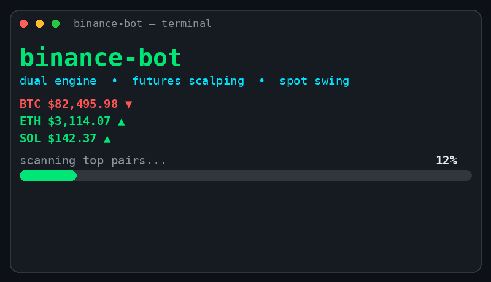

# binance-bot



A simple toolset: **LONG + SHORT signal scanner** + **Binance USDT-M Futures auto-trading** — plus a **spot swing engine** in the same repo.

Rebuilt from scratch — focused on a bidirectional signal engine, not a full port of the old bot.

## Features

- **LONG and SHORT** (default `BULLISH_ONLY=False`)
- 15m setups: EMA 9/21/50, RSI, MACD, volume
- **Noise filter**: Efficiency Ratio, doji, direction flips, DI conflict, overextension
- **MTF weighted**: hard 1h gate, weighted 1h/30m/15m/5m score ≥ 0.70
- Optional **BTC align** (15m)
- Freshness vs entry zone
- Quality score ≥ `MIN_QUALITY`
- Auto entry LIMIT/MARKET + STOP_MARKET SL + TAKE_PROFIT_MARKET TP1
- Modes: `paper` | `testnet` | `live`

## Install

```bash
cd binance-bot
python3 -m venv .venv
source .venv/bin/activate   # Windows: .venv\Scripts\activate
pip install -r requirements.txt
cp .env.example .env
# edit .env — fill in your testnet API key
```

Load env (optional):

```bash
export $(grep -v '^#' .env | xargs)
```

## Commands

```bash
# One scan pass (public data, no API key required)
python main.py scan

# Show fresh signals
python main.py signals

# Auto-trade from signals (needs testnet/live keys)
python main.py trade

# Scan + trade once
python main.py run

# Continuous loop (default 15 minutes)
python main.py loop
python main.py loop --interval 600

# Account
python main.py balance
python main.py positions

# SPOT engine (swing, LONG-only, no SL)
python main.py spot-scan
python main.py spot-trade
python main.py spot-loop
python main.py spot-loop --interval 900

# Runtime settings (apply on the next cycle, no restart)
python main.py settings
python main.py set leverage 20
python main.py set tp_roi_pct 30
python main.py set margin_usd 100
```

## Signal engine (summary)

```
24h volume
  → 15m BULLISH/BEARISH WATCH (strength ≥ 3)
  → regime brake (RANGING = no-trade zone, REGIME_BLOCK_RANGING)
  → noise filter
  → MTF (1h hard, weighted score ≥ 0.70 from EMA-trend legs 1h/30m/15m/5m)
  → BTC align (optional: 15m vote + 1h trend must not oppose)
  → live-price freshness
  → quality ≥ MIN_QUALITY
  → LONG or SHORT SIGNAL
```

## Two engines: futures + spot

| | Futures (daily scalping) | Spot (swing) |
|---|---|---|
| Trigger | 15m | 1h |
| MTF | 1h/30m/15m/5m (hard 1h) | 4h/1h/30m/15m (hard 4h) |
| Direction | LONG + SHORT | LONG only (spot cannot short) |
| SL | STOP_MARKET via Algo Order | NONE (spot cannot liquidate) |
| Exit | SL / exchange TP1 + bot profit-take | Bot-side TP1 full close |
| Sizing | Fixed margin / risk | Fixed USDT per buy |
| State | executor_state.json | spot_state.json |
| Signals | signals.db | spot_signals.db |

Spot uses HH/HL market structure as a gate plus candle patterns
(bullish engulfing, hammer) as a quality bonus. Spot keys are
SEPARATE from futures keys: spot testnet keys come from
testnet.binance.vision (`SPOT_API_KEY`/`SPOT_API_SECRET`), not from
the futures testnet. Spot v1 limits: full close at TP1 only (TP2 is
recorded for a future partial-exit), no reversal exit yet, and the
0.1% fee is not modeled.

## Risk

- Default is **testnet**. Live only when `TRADE_MODE=live` **and** `LIVE_CONFIRM=YES`.
- Size = `RISK_PCT%` of equity / entry−stop distance.
- Max open positions: `MAX_OPEN_POSITIONS`.
- Default margin is **ISOLATED** (`MARGIN_MODE`). A failed margin/leverage set cancels the entry.
- SL/TP are attached **after the entry fills** (LIMIT fills are waited on/polled; unfilled orders are recorded as pending and reconciled on the next pass; pending orders past `ORDER_TTL_SEC` are cancelled). If SL cannot be attached after a fill (3 retries), the position is **emergency-closed** via market reduce-only — no naked position is ever left open.
- **Kill switch**: create a `KILL` file in the `data/` folder → all new entries are blocked.
- **Daily loss cap**: entries are blocked when equity drops more than `DAILY_LOSS_CAP_PCT%` from the start-of-day equity (recorded in `executor_state.json`).
- Entries are skipped when notional (qty × price) is below the exchange MIN_NOTIONAL / `MIN_NOTIONAL_USDT`.

## Data files

```
data/signals.db      # signals
data/state.json      # last scan summary
data/executor_state.json
data/bot.log
```

## Key configuration

| Env / config | Default | Meaning |
|--------------|---------|---------|
| `TRADE_MODE` | testnet | paper / testnet / live |
| `BULLISH_ONLY` | False | False = LONG+SHORT |
| `MIN_QUALITY` | 62 | quality gate |
| `BTC_ALIGN` | 1 | BTC direction must agree |
| `RISK_PCT` | 1.0 | % equity per trade |
| `MAX_LEVERAGE` | 5 | leverage |
| `MARGIN_MODE` | ISOLATED | ISOLATED / CROSSED |
| `MIN_NOTIONAL_USDT` | 5 | minimum notional per entry |
| `DAILY_LOSS_CAP_PCT` | 10 | block entries when daily equity drops past this % |
| `ORDER_TTL_SEC` | 1800 | max age of a pending LIMIT order before cancellation |
| `UNIVERSE` | top | top volume or a list |

## Disclaimer

Educational/automation tooling. Futures trading is high risk. Test on **testnet** first. No profit is guaranteed.
